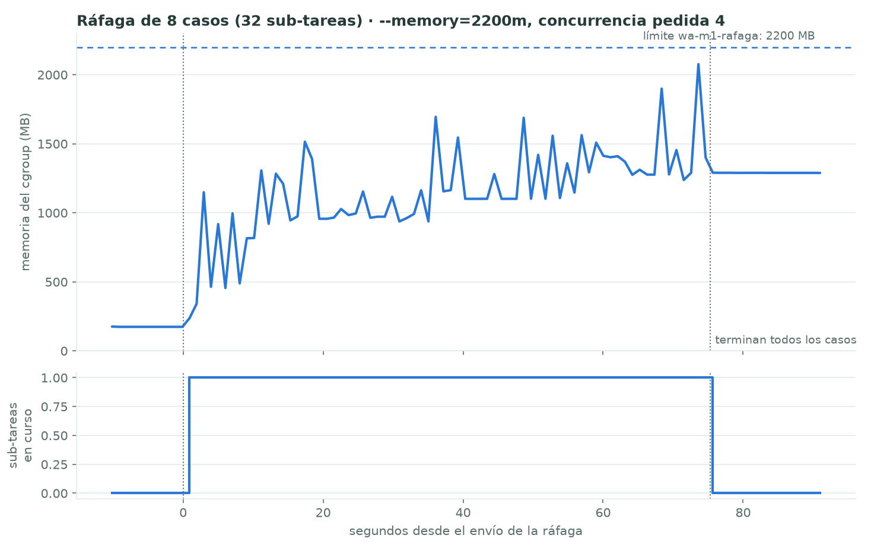

# Módulo M1 · Gestión de memoria          Responsable: Sharon Blanco

## 1. Qué se implementó

| Requisito del enunciado | Implementación | Ruta |
|---|---|---|
| Límite de memoria por worker (cgroups v2) | Cada worker corre en Docker con `--memory=X --memory-swap=X`. Al no tener swap, si se pasa del límite el kernel mata el proceso (OOM) en vez de ralentizar todo el nodo. El worker lee su límite y su uso desde `/sys/fs/cgroup/memory.{max,current,peak,events}`. | `distribuido/worker/Dockerfile`, `distribuido/worker/memoria.py` |
| Huella RSS/PSS de cada modelo | Se mide cada modelo en un proceso nuevo, dentro de la misma imagen que usan los nodos. Hay tres fases: importar la librería, cargar el modelo e inferir dos veces. Antes de cada fase se reinicia el pico del proceso con `/proc/self/clear_refs`. El resultado queda en `huella_modelos.json`, que es lo que consume el plan. | `distribuido/m1/medir_modelos.py`, `distribuido/worker/huella_modelos.json` |
| Control de admisión | **(a) Plan del nodo, al arrancar:** con el límite del cgroup menos un margen del 10 % y las huellas medidas, decide qué pools atiende el worker, si el texto usa el modelo o solo reglas, qué tamaño de Whisper usa y cuántas sub-tareas corre a la vez. Lo que no cabe se degrada o se deja a otro nodo. **(b) En ejecución:** antes de empezar una sub-tarea reserva su memoria de trabajo, como un semáforo contado en MB. Si no hay memoria, la sub-tarea espera; además se compara con el uso real del cgroup. `python distribuido/worker/memoria.py --nodo 12g` calcula cuántos workers caben en un nodo. | `memoria.py` (`planificar`, `Admision`), `worker.py` (`preparar_memoria`, `manejar`) |
| Detectar OOM y reencolar con una política definida | `supervisor.py` es el proceso principal del contenedor y lanza el worker como proceso hijo. Si el hijo muere con SIGKILL **y** sube el contador `oom_kill` de `memory.events`, se trata de un OOM. En ese caso el supervisor anota qué sub-tareas estaban en curso, avisa al coordinador (alerta en el dashboard) y reinicia el worker con espera exponencial (1, 2, 4… hasta 30 s). La sub-tarea no se pierde: no tenía ACK, así que RabbitMQ la re-entrega. **Política:** la 1.ª vez que una sub-tarea provoca OOM en un nodo, se reintenta **sola** (modo exclusivo, sin otras en paralelo). La 2.ª vez el nodo la **rechaza** como fallo reintentable: el coordinador la re-encola (máx. 3 veces) y la puede tomar un nodo con más memoria. Si ninguno puede, queda `failed`. Nunca entra en un bucle infinito. | `distribuido/worker/supervisor.py`, `memoria.Registro`, `coordinador.py` (`_oom`) |
| Estrategia de carga de modelos | Se compararon tres estrategias: un modelo por proceso, fork después de cargar (copy-on-write) y hilos que comparten el modelo. Se eligió **un proceso por nodo con el modelo cargado una vez y compartido por hilos**; la justificación está en la sección 5. | `distribuido/m1/estrategias_carga.py` |
| Memoria en el tiempo | Cada latido del worker (cada 1 s en las pruebas) lleva el uso del cgroup, el RSS, el PSS, la memoria reservada, los OOM y los reinicios. El coordinador lo guarda en `.metricas/memoria_workers.csv`, y el dashboard (vista Workers, columna "Memoria (M1)") muestra el uso frente al límite. | `coordinador.py` (`_anotar_memoria`), `distribuido/m1/graficar_memoria.py`, `mensajeria/web/index.html` |

## 2. Concepto de Sistemas Operativos
- **Control de recursos con cgroups v2.** El kernel cobra al grupo de procesos la memoria anónima y la caché de páginas, y aplica el límite con el *OOM killer* del propio cgroup. Ref.: documentación del kernel Linux, *Control Group v2 – Memory*.
- **Paginación por demanda.** Los pesos del modelo de texto se leen con `mmap` (safetensors) y entran a la RAM recién en la primera inferencia. Ref.: Silberschatz, Galvin y Gagne, *Operating System Concepts*, 10.ª ed., cap. 10 (§10.2).
- **Copy-on-write tras `fork()`.** Padre e hijos comparten las páginas físicas hasta que alguno las escribe (§10.3).
- **RSS frente a PSS frente a USS.** RSS cuenta las páginas compartidas una vez por proceso; PSS las reparte entre los procesos que las comparten; USS cuenta solo las privadas.
- **Asignación de marcos, sobrecompromiso y OOM.** Admitir solo la carga que cabe evita que el sistema colapse por falta de memoria; es la misma idea que el control de admisión del *working set* (§10.5–10.6). También en Tanenbaum y Bos, *Modern Operating Systems*, 4.ª ed., cap. 3.

## 3. Método de medición
Equipo: Intel i7-12700H (20 hilos), 16 GB de RAM, Linux 7.0, Docker con cgroups v2. Imagen `wa-worker`: Python 3.11, PyTorch 2.15 CPU. Todos los comandos están en `distribuido/m1/experimentos.sh` (`huella`, `estrategias`, `rafaga`, `oom` y `admision`). Las pruebas usan solo el **dataset generado** (`dataset_generado/importados/`) y colas aparte (`wa.m1.`).

| Medición | Comando | Detalle |
|---|---|---|
| Huella por modelo | `bash distribuido/m1/experimentos.sh huella` | Un proceso nuevo por modelo, en un contenedor con `--memory=2g`. RSS, PSS y USS desde `/proc/self/smaps_rollup`; pico desde `VmHWM`. Entradas: 256 mensajes; 5 fotos de Open Images; 3 audios de FLEURS. |
| Texto según el tamaño del bloque | `python /m1/texto_por_bloque.py` (dentro de la imagen) | Bloques de 32, 64, 256 y 1024 mensajes; pico de la 2.ª inferencia. |
| Estrategias de carga | `bash distribuido/m1/experimentos.sh estrategias` | N = 1, 2 y 3 "workers" con el modelo de texto, en un contenedor con `--memory=3g`. Se suma el PSS de todos los procesos vivos tras una inferencia de cada uno. |
| OOM provocado | `bash distribuido/m1/experimentos.sh oom` | Worker de texto con `--memory=700m` y `WA_ADMISION=0`; 1 caso dividido en 2 bloques. |
| Mismo caso, con admisión | `bash distribuido/m1/experimentos.sh admision` | Igual que el anterior, pero con el control de admisión activo. |
| Ráfaga / saturación (B.6) | `bash distribuido/m1/experimentos.sh rafaga` | 8 casos (32 sub-tareas) enviados a la vez a un worker con `--memory=2200m` y `WORKER_CONCURRENCIA=4`. |

Repeticiones: las huellas se midieron 2 veces (variación de 3 % o menos) y los demás experimentos 1 vez.

## 4. Resultados

### 4.1 Huella de memoria por modelo (proceso nuevo, CPU)
| Modelo | Importar librerías | Al cargar | Residente tras la 1.ª inferencia | Pico de la 1.ª inferencia | **Trabajo por sub-tarea** (pico de la 2.ª) | Proceso al final RSS / PSS / USS |
|---|---|---|---|---|---|---|
| Base del worker (pika, estadísticas) | — | — | — | — | — | 24 / 22 / 19 MB |
| Texto: pysentimiento (RoBERTuito) | 449 MB | +31 MB | +477 MB | +1281 MB | **+818 MB** | 940 / 937 / 934 MB |
| Imagen: YOLOv8-l Open Images | 245 MB | +183 MB | +577 MB | +624 MB | **+44 MB** | 867 / 864 / 861 MB |
| Audio: Whisper small int8 | 47 MB | +509 MB | +664 MB | +764 MB | **+101 MB** | 723 / 720 / 717 MB |
| Audio: Whisper medium int8 | 47 MB | +1540 MB | — | +426 MB sobre lo cargado | — | 1837 MB (con `--memory=2g`, en la 2.ª corrida el kernel lo mató por OOM) |

**Memoria de trabajo del texto según el tamaño del bloque**

| Mensajes por sub-tarea | 32 | 64 | 256 | 1024 |
|---|---|---|---|---|
| Pico de trabajo | 820 MB | 817 MB | 818 MB | 819 MB |
| Tiempo | 1,2 s | 1,3 s | 2,2 s | 5,7 s |

### 4.2 Estrategias de carga del modelo de texto (suma de PSS tras una inferencia)
| Workers (N) | Un modelo por proceso | Fork + copy-on-write | Hilos (un proceso) |
|---|---|---|---|
| 1 | 931 MB | 968 MB | 927 MB |
| 2 | 1298 MB | 1021 MB (suma de RSS: 2148 MB) | 1096 MB |
| 3 | **✗ OOM** (no cupo en 3 GB) | **1074 MB** (suma de RSS: 2969 MB; USS: 299 MB) | **1003 MB** |
| Memoria por worker adicional | ≈ +370 MB y luego OOM | ≈ +50 MB | ≈ +40 MB |

Datos: `docs/mediciones/m1/estrategias_carga.json`.

### 4.3 OOM provocado frente a control de admisión (`--memory=700m`, 1 caso de 2 bloques)
| | Sin admisión (`WA_ADMISION=0`) | Con admisión |
|---|---|---|
| Plan al arrancar | texto con modelo (1158 MB fijos, más de 630 MB de presupuesto) | **texto sin modelo (solo reglas)**: "el modelo necesita 1744 MB" |
| OOM del kernel (`memory.events`) | **4** (2 por sub-tarea) | **0** |
| Reinicios del worker | 4 (espera de 2, 4, 8 y 16 s) | 0 |
| Política aplicada | 1.º OOM → reintento solo; 2.º → rechazo; el coordinador reintentó 3 veces | — |
| Estado final del caso | `failed` en 57,7 s, sin bucle | `completed` en ~1 s |
| Pico del cgroup | 700 MB (el límite) | 175 MB |

Datos: `docs/mediciones/m1/oom/` (`resumen.json`, `worker.log`, `memoria.png`) y `docs/mediciones/m1/admision/`.

### 4.4 Ráfaga con saturación de memoria (B.6)
8 casos y 32 sub-tareas de texto enviados a la vez. El worker tiene `--memory=2200m` y pide `WORKER_CONCURRENCIA=4`.

| Métrica | Valor |
|---|---|
| Concurrencia que permitió la admisión | **1** (por memoria: 1158 MB fijos + 818 MB de trabajo ≤ 1980 MB de presupuesto; una 2.ª sub-tarea no cabe) |
| Pico de memoria del cgroup | **2077 MB de 2200 MB (94 %)** |
| OOM / reinicios | **0 / 0** |
| Sub-tareas completadas | 32 / 32 |
| Duración total · throughput | 75,3 s · 6,4 casos/min (0,43 sub-tareas/s) |
| Latencia por caso | p50 44,4 s · p95 62,9 s |

## 5. Interpretación
- **La huella real no es el tamaño del archivo del modelo.** RoBERTuito pesa 416 MB en disco, pero el proceso llega a 940 MB residentes, con 1281 MB de pico la primera vez. Medir era necesario: con el tamaño del archivo, el plan habría admitido cargas que terminan en OOM.
- **La paginación por demanda se ve en los datos.** Al "cargar" el modelo de texto, el RSS sube solo 31 MB: safetensors mapea los pesos con `mmap`. Esas páginas entran a la RAM durante la 1.ª inferencia (+477 MB residentes). Por eso el plan separa la memoria **fija** del modelo de la memoria **de trabajo** por sub-tarea.
- **El costo de trabajo del texto es fijo, no proporcional al bloque.** Son unos 818 MB por llamada, ya sean 32 o 1024 mensajes. Probablemente pysentimiento arma un `Trainer` en cada `predict()`. Para la memoria conviene entonces **dividir en pocos bloques grandes**, y el control de admisión reserva 818 MB por cada sub-tarea de texto simultánea. Una mejora posible sería llamar al modelo directamente, sin `Trainer`.
- **El control de admisión evita el colapso.** Con el mismo límite de 700 MB, sin admisión hubo 4 OOM y el caso falló. Con admisión no hubo ninguno y el caso terminó, aunque con menos capacidad: solo reglas, sin el modelo. En la ráfaga, el worker pidió 4 sub-tareas a la vez y la admisión lo limitó a 1. El pico quedó en 94 % del límite, sin OOM. La política del supervisor también funcionó: detectó el OOM con el contador del kernel, reintentó la sub-tarea sola, la rechazó al segundo OOM y el coordinador la dio por fallida tras 3 reintentos, sin bucle infinito.
- **Estrategia de carga: fork y copy-on-write cumplen la teoría.** Con 3 workers, la suma de RSS da 2969 MB pero la de PSS solo 1074 MB, y el USS de los hijos es de unos 100 MB cada uno. Casi todo el modelo se comparte; cada hijo copia solo las páginas que escribe (contadores de referencias de Python, buffers temporales). `gc.freeze()` antes del fork ayuda a que el recolector no las toque. Con procesos independientes, el 3.º no cupo en 3 GB. Con 2 independientes se usaron 1298 MB y no 1862: las páginas de un archivo mapeado con `mmap` también se comparten entre procesos sin relación, a través de la caché de páginas.
- **Por qué elegimos hilos.** Hilos y fork usan casi lo mismo (1003 frente a 1074 MB con N = 3). Los hilos no tienen el problema de que CUDA no funciona después de `fork()`, ni el riesgo de copias por copy-on-write. Además, la inferencia ocurre en C++ (PyTorch y CTranslate2) y libera el GIL, así que los hilos sí corren en paralelo. Por eso el worker usa **un proceso por nodo con cada modelo cargado una sola vez y compartido por los hilos de las sub-tareas**. Para escalar se agregan nodos o contenedores, cada uno con su límite. Fork sería la alternativa si hiciera falta aislar fallos entre sub-tareas.
- **Limitaciones.**
  - La memoria de trabajo del audio se midió con audios de 10 a 20 s; una nota de voz muy larga necesita más. El margen del 10 % y la comprobación con el uso real del cgroup cubren parte de eso.
  - La memoria del worker sube despacio después de muchas sub-tareas, de unos 1100 a unos 1300 MB en reposo. Probablemente es fragmentación del asignador de glibc. Por eso el plan deja un margen y el supervisor reinicia el worker si de todos modos llega al OOM.
  - Whisper tiny y base no se midieron (no estaban descargados): el plan solo considera los tamaños medidos.
