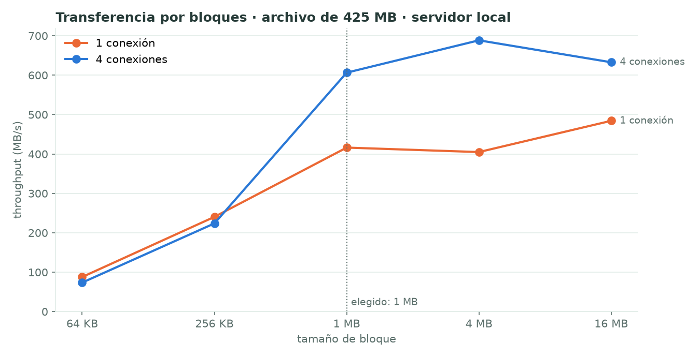
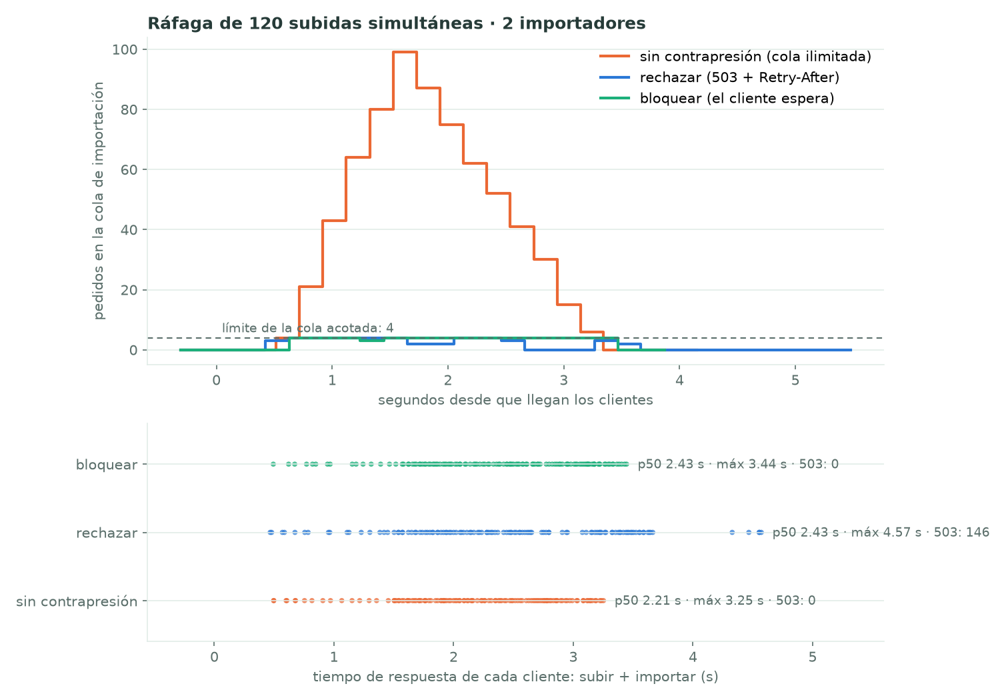

# Módulo M3 · E/S y almacenamiento          Responsable: Sharon Blanco

## 1. Qué se implementó

| Requisito del enunciado | Implementación | Ruta |
|---|---|---|
| **Almacenamiento direccionado por contenido (SHA-256) con deduplicación** | Cada adjunto se guarda **una sola vez** en `dataset_whatsapp/.almacen/ab/abcd…`, con su SHA-256 como nombre. La carpeta de cada caso no guarda copias sino **enlaces duros** (*hard links*) a esos archivos: otro nombre para el mismo inodo, sin espacio extra. Si el SHA-256 ya existe en el almacén, no se copia nada: eso es la deduplicación. Al borrar un caso, el **recolector** elimina los archivos del almacén cuyo contador de enlaces del inodo (`st_nlink`) quedó en 1, es decir, que ya no usa ningún caso. Los archivos del almacén son de solo lectura y `verificar()` recalcula cada SHA-256 para detectar alteraciones. | `mensajeria/almacen.py`, `mensajeria/importar.py`, `mensajeria/web.py` (al eliminar un caso) |
| **Transferencia de archivos grandes en bloques, con reensamblado verificado por hash** | El coordinador publica un **manifiesto** (`GET /manifiesto/<caso>/<archivo>?bloque=N`) con el tamaño, el SHA-256 total y el SHA-256 de cada bloque. El worker pide los bloques con **HTTP Range**, usando **4 conexiones keep-alive** en paralelo (HTTP/1.1, una conexión TCP reutilizada por hilo). Cada bloque se verifica al llegar; si su hash no coincide, **se repite solo ese bloque** (hasta 3 veces). Los bloques se escriben en su posición con `os.pwrite` (**reensamblado**) y al final se verifica el SHA-256 del archivo completo contra el registrado al importar. Tamaño de bloque: **1 MB** (`WA_BLOQUE_KB`), justificado en la sección 5. | `mensajeria/web.py` (`ManejadorWorkers`), `distribuido/worker/worker.py` (`descargar_por_bloques`) |
| **Recepción de archivos con E/S asíncrona** | Receptor nuevo con **asyncio** (puerto 8102, solo 127.0.0.1). Un único hilo con un bucle de eventos atiende muchas subidas a la vez: `await lector.read()` cede el turno mientras no llegan bytes, y la escritura a disco se hace en bloques de 1 MB en un hilo auxiliar (`asyncio.to_thread`), así el bucle nunca se bloquea. La interfaz web sube por este receptor; si no está disponible, usa la ruta anterior. | `mensajeria/receptor.py`, `mensajeria/web/index.html` (`importarSeleccion`) |
| **Contrapresión (backpressure): colas acotadas que bloquean o rechazan a los productores** | **(a) Cola de importación acotada:** `asyncio.Queue(maxsize=4)` que vacían 2 importadores. Cuando está llena, la política `WA_CONTRAPRESION` decide: **`rechazar`** (por defecto) responde `503` con `Retry-After`, que se calcula con el tiempo medio de importación y los pedidos que hay delante, y la interfaz reintenta sola mostrando "cola llena, reintentando"; **`bloquear`** hace esperar al pedido hasta que haya lugar; **`ninguna`** usa una cola sin límite, solo para comparar. **(b) Subidas simultáneas acotadas** (`WA_SUBIDAS_MAX=8`): las que sobran esperan **sin que se lea su cuerpo**, así el búfer de TCP se llena y el **control de flujo de TCP** frena al navegador. | `mensajeria/receptor.py` |

## 2. Concepto de Sistemas Operativos
- **Sistemas de archivos: inodos, enlaces duros y contador de enlaces.** Un nombre de archivo es una entrada de directorio que apunta a un inodo; varios nombres pueden apuntar al mismo. El inodo se libera cuando su contador (`st_nlink`) llega a 0. Ref.: Silberschatz, Galvin y Gagne, *Operating System Concepts*, 10.ª ed., cap. 13–14 (interfaz e implementación del sistema de archivos).
- **Integridad y almacenamiento direccionado por contenido.** El nombre es el hash del contenido, así que el almacén detecta cualquier alteración y deduplica sin buscar.
- **E/S bloqueante frente a no bloqueante o asíncrona.** Un bucle de eventos (`select`/`epoll` por debajo de asyncio) multiplexa muchas conexiones en un hilo. Ref.: Silberschatz, cap. 12 (sistemas de E/S: *nonblocking and asynchronous I/O*).
- **Productor-consumidor con búfer acotado y control de flujo.** La cola acotada es el problema clásico del búfer limitado: el productor se bloquea o es rechazado cuando el búfer está lleno. El control de flujo de TCP aplica la misma idea en la red. Ref.: Silberschatz, cap. 7 (*bounded-buffer problem*).
- **Tamaño de bloque de E/S.** Hay que equilibrar el costo fijo por operación (latencia, cabeceras, llamadas al sistema) contra el costo de repetir un bloque dañado y la memoria por bloque.

## 3. Método de medición
Equipo: Intel i7-12700H, 16 GB de RAM, Linux 7.0, Python 3.13. Los comandos exactos están en `distribuido/m3/experimentos.sh`.

| Medición | Comando | Condiciones |
|---|---|---|
| Deduplicación | `python mensajeria/almacen.py --dataset dataset_whatsapp --migrar --verificar` | Todos los casos importados (40 del dataset generado y los chats del equipo). Se separa además el dataset generado. Prueba controlada: el mismo caso importado dos veces. |
| Throughput según el tamaño de bloque | `python distribuido/m3/medir_bloques.py --caso 040_fernanda_mora` | Video de 425 MB, servidor de los workers en la misma máquina (loopback), bloques de 64 KB, 256 KB, 1 MB, 4 MB y 16 MB, con 1 y 4 conexiones. 3 repeticiones; se reporta la mediana. Cada descarga se verifica completa por SHA-256. |
| Bloque dañado | prueba en la que el bloque 3 llega alterado la primera vez | Mismo video, bloques de 1 MB. |
| Ráfaga de subidas | `python distribuido/m3/rafaga_subidas.py --clientes 120` | 120 clientes suben a la vez un chat del dataset generado (21 chats con fotos y audios, 75 MB en total) y piden importarlo. Cola de 4 y 2 importadores. Se repite con las 3 políticas. La profundidad de la cola se muestrea cada 0,2 s. |

## 4. Resultados

### 4.1 Deduplicación
| Conjunto | Adjuntos | Únicos | Sin deduplicar | En disco | Tasa (bytes) |
|---|---|---|---|---|---|
| Prueba controlada: el mismo chat importado 2 veces | 40 | 20 | 6,1 MB | 3,0 MB | **50,0 %** |
| Dataset generado (40 casos) | 470 | 469 | 2681 MB | 2256 MB | **15,9 %** (un video de 425 MB repetido en dos casos pesados) |
| Todo lo importado (generado + chats del equipo) | 782 | 764 | 2740 MB | 2311 MB | **15,7 %** (ahorro de 430 MB) |

`verificar()` recalculó el SHA-256 de los 764 archivos del almacén: todos coinciden con su nombre. Al borrar las dos copias de la prueba controlada, el recolector liberó los 20 archivos. Mientras quedaba un caso que los usaba, no borró ninguno.

### 4.2 Throughput según el tamaño de bloque (video de 425 MB, mediana de 3)
| Bloque | Pedidos | 1 conexión | 4 conexiones | Se repite si un bloque se daña | Memoria en vuelo (4 conexiones) |
|---|---|---|---|---|---|
| 64 KB | 6804 | 88 MB/s | 74 MB/s | 64 KB | 256 KB |
| 256 KB | 1701 | 240 MB/s | 224 MB/s | 256 KB | 1 MB |
| **1 MB** | **426** | **416 MB/s** | **606 MB/s** | **1 MB** | **4 MB** |
| 4 MB | 107 | 405 MB/s | 688 MB/s | 4 MB | 16 MB |
| 16 MB | 27 | 484 MB/s | 633 MB/s | 16 MB | 64 MB |

**Bloque dañado** (bloque 3 alterado la primera vez): se detectó por su hash, se pidió de nuevo **solo ese bloque** (1 MB de 425 MB) y el SHA-256 del archivo reensamblado coincidió.

### 4.3 Ráfaga de 120 subidas simultáneas
| Política | Profundidad máxima de la cola | Espera en la cola (p50 / máx) | Respuestas 503 | Tiempo por cliente (p50 / máx) | Duración total | Importados |
|---|---|---|---|---|---|---|
| Sin contrapresión (cola ilimitada) | **102** | 1,20 / 1,75 s | 0 | 2,21 / 3,25 s | 3,3 s | 120/120 |
| **Rechazar** (503 + Retry-After) | **4** | **0,05 / 0,35 s** | 146 | 2,43 / 4,57 s | 4,6 s | 120/120 |
| Bloquear | **4** | 1,38 / 1,85 s* | 0 | 2,43 / 3,44 s | 3,5 s | 120/120 |

\* Con "bloquear", el tiempo esperando lugar en la cola se cuenta como espera.

Datos: `docs/mediciones/m3/` (`bloques_local.json`, `rafaga_subidas.json`, `cola_*.csv` y `deduplicacion.txt`).

## 5. Interpretación
- **Tamaño de bloque: 1 MB.** Con bloques chicos domina el costo fijo de cada pedido (cabeceras HTTP, ida y vuelta, llamadas al sistema): con 64 KB hacen falta 6804 pedidos y la descarga es **7 veces más lenta** que con 1 MB. Desde 1 MB la curva se aplana: 4 MB solo gana un 13 % con 4 conexiones, pero cuadruplica lo que hay que repetir si un bloque se daña y la memoria en vuelo. 1 MB queda en el "codo" de la curva, como predice la teoría de tamaño de bloque de E/S.
- **El paralelismo solo ayuda con bloques grandes.** Con 64–256 KB, 4 conexiones no mejoran porque el costo por pedido es de CPU (Python y el GIL), no de espera de red. Con 1 MB o más, mientras una conexión espera, otra transfiere.
- **La verificación por bloque abarata los errores.** Un error de transmisión cuesta repetir 1 MB, no 425 MB, y el SHA-256 final garantiza que el reensamblado es idéntico al original.
- **La deduplicación depende de los datos.** En el dataset generado casi no hay archivos repetidos (1 de 470), pero ese uno es un video de 425 MB: el ahorro por espacio (15,9 %) es mucho mayor que por cantidad (0,2 %). En chats reales los reenvíos son frecuentes (stickers, memes, fotos reenviadas): de los 18 repetidos detectados, 17 están en los chats del equipo. Los enlaces duros consiguen la deduplicación **sin cambiar ninguna ruta** de la aplicación.
- **La contrapresión acota los recursos del servidor, a costa de algo de latencia.** Sin límite, la cola llegó a **102 pedidos**: el servidor acepta todo y cada pedido espera más cuanto más llega, así que con una ráfaga mayor la memoria, los descriptores abiertos y el disco temporal crecerían sin tope. Con "rechazar", la cola **nunca pasó de 4** y un pedido aceptado esperó como máximo 0,35 s. El costo: 146 respuestas 503 y una duración total un 40 % mayor (4,6 frente a 3,3 s), porque los clientes reintentan según `Retry-After`. Con "bloquear", la cola también quedó en 4 y la duración fue casi igual a la de sin límite, pero los clientes esperan con la conexión abierta: es más simple para el cliente, pero ocupa una conexión por cliente. Coincide con la teoría del búfer acotado: el límite pasa la presión al productor, que espera o reintenta, en vez de acumularla en el servidor.
- **Limitaciones.**
  - El throughput se midió en loopback, sin red real; a través del túnel o de internet la latencia por pedido es mayor, lo que favorece todavía más los bloques de 1 MB o más y las 4 conexiones. Se puede medir con `medir_bloques.py --url https://….trycloudflare.com`.
  - La ráfaga dura pocos segundos porque, con el almacén, importar es rápido. Con más clientes o chats más pesados las diferencias crecen en la misma dirección.
