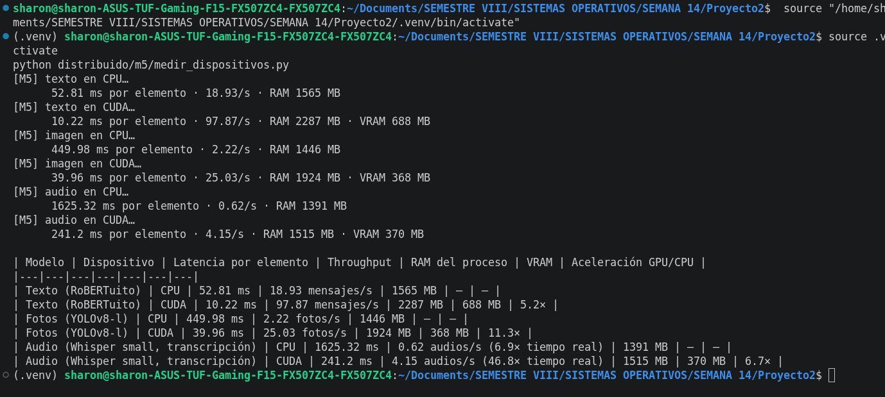

# Módulo M5 · Cómputo heterogéneo          Responsable: Sharon Blanco

## 1. Qué se implementó

| Parte | Implementación | Ruta |
|---|---|---|
| **Medición de la inferencia en CPU frente a GPU** | Script que mide los tres modelos de la plataforma (texto, fotos y audio) en CPU y en GPU. Para cada combinación lanza un proceso nuevo, carga el modelo, hace una inferencia de calentamiento y mide latencia, throughput, RAM y VRAM. En las corridas de CPU el proceso **no ve la GPU** (`CUDA_VISIBLE_DEVICES=""`). | `distribuido/m5/medir_dispositivos.py` |
| **Modelo cuantizado frente a no cuantizado** | Whisper en `float16` contra `int8_float16` (GPU) y en `int8` (CPU), con el error de transcripción (WER) de cada uno. | `docs/mediciones/audio_whisper.md` |
| **Cada worker se adapta a su hardware** | `dispositivo()` elige GPU si hay y CPU si no. `tamano_whisper()` elige *medium* en GPU y *small* en CPU, según las mediciones. Con `WA_DISPOSITIVO=cpu` el worker oculta la GPU antes de cargar los modelos: antes de esta corrección, pysentimiento usaba la GPU aunque el nodo estuviera configurado como "solo CPU". Cada latido informa al coordinador el dispositivo del nodo, y el dashboard lo muestra en la vista Workers. | `distribuido/worker/detectores.py`, `distribuido/worker/worker.py` |
| **Política de routing** | Definida con los datos de la sección 4 (ver sección 5). Se aplica en el despachador del coordinador (`_despachar()`), junto con el planificador de M2, que decide qué tarea sale y hacia qué worker. | `distribuido/coordinador.py` |

## 2. Concepto de Sistemas Operativos (conexión con la Unidad 1)
- **CPU:** pocos núcleos potentes, optimizados para **baja latencia** y lógica con muchas ramas.
- **GPU:** miles de núcleos simples que ejecutan la misma instrucción sobre muchos datos (SIMT). Es ideal para **paralelismo masivo**, como multiplicaciones de matrices y convoluciones.
- **NPU:** acelerador específico para inferencia, en **baja precisión** (int8 o int4), con muy poco consumo.
- Un sistema heterogéneo debe asignar cada tarea al procesador donde rinde más, **con datos medidos, no por intuición** (enunciado, M5).
- La cuantización int8 que usamos en Whisper es la misma idea que explota una NPU: menos bits por operación, a cambio de casi ninguna pérdida de precisión.
- Ref.: Silberschatz, Galvin y Gagne, *Operating System Concepts*, 10.ª ed., cap. 1 (organización del computador, procesadores y aceleradores) y cap. 5 (planificación de CPU en sistemas heterogéneos y multiprocesador).

## 3. Método de medición
- **Comando:** `python distribuido/m5/medir_dispositivos.py`
- **Equipo:** Intel i7-12700H (20 hilos) con 16 GB de RAM; GPU NVIDIA RTX 3050 Laptop de 4 GB; PyTorch 2.15 (CUDA) y faster-whisper 1.2.1.
- **Datos (públicos):**
  - texto: 512 comentarios de OffendES;
  - fotos: 30 imágenes de Open Images;
  - audio: 15 audios de FLEURS, 169 s en total.
- **Configuraciones:**
  - texto: pysentimiento (RoBERTuito) en un solo lote;
  - fotos: YOLOv8-l, una foto por llamada;
  - audio: Whisper *small* (CPU `int8`, GPU `int8_float16`). Se mide solo la transcripción: el texto de los segmentos se analiza con reglas, para no mezclar el costo del modelo de texto.
- Se mide después de la carga y una inferencia de calentamiento. La RAM es el RSS del proceso; la VRAM es la diferencia de `torch.cuda.mem_get_info()`.
- **Captura de la corrida:** `docs/mediciones/m5/captura_dispositivos.png`.

## 4. Resultados

### 4.1 Latencia, throughput y memoria por configuración
| Modelo | Dispositivo | Latencia por elemento | Throughput | RAM del proceso | VRAM | Aceleración GPU/CPU |
|---|---|---|---|---|---|---|
| Texto (RoBERTuito) | CPU | 52,8 ms | 18,9 mensajes/s | 1565 MB | — | — |
| Texto (RoBERTuito) | GPU | 10,2 ms | 97,9 mensajes/s | 2287 MB | 688 MB | **5,2×** |
| Fotos (YOLOv8-l) | CPU | 450,0 ms | 2,2 fotos/s | 1446 MB | — | — |
| Fotos (YOLOv8-l) | GPU | 40,0 ms | 25,0 fotos/s | 1924 MB | 368 MB | **11,3×** |
| Audio (Whisper small) | CPU | 1625 ms | 0,62 audios/s (6,9× tiempo real) | 1391 MB | — | — |
| Audio (Whisper small) | GPU | 241 ms | 4,15 audios/s (46,8× tiempo real) | 1515 MB | 370 MB | **6,7×** |

### 4.2 Cuantización (Whisper; de `docs/mediciones/audio_whisper.md`)
| Modelo | Dispositivo | Precisión | WER mediana | Velocidad | VRAM |
|---|---|---|---|---|---|
| small | GPU | float16 | 0,048 | 57× tiempo real | 576 MB |
| small | GPU | **int8_float16** | **0,048** | 61× tiempo real | **288 MB** |
| small | CPU | int8 | 0,048 | 7,7× tiempo real | — |
| medium | GPU | float16 | — | **no cupo en 4 GB (OOM)** | — |
| medium | GPU | int8_float16 | 0,048 | 26× tiempo real | 928 MB |

Datos: `docs/mediciones/m5/dispositivos.json` y `dispositivos.md`.

## 5. Interpretación y política de routing
- **La aceleración depende de cuánto paralelismo tiene la tarea**, como predice la teoría:
  - **YOLO (11,3×)** es una red de convoluciones sobre una imagen entera: millones de operaciones independientes, justo lo que aprovechan los miles de núcleos de la GPU.
  - **Whisper (6,7×)** también es pesado en matrices, pero decodifica el texto palabra por palabra, y ese paso secuencial no se paraleliza.
  - **El texto (5,2×)** procesa frases cortas: hay menos trabajo paralelo por llamada y pesa más el costo fijo de cada llamada (el `Trainer` de pysentimiento, ver M1).
- **La GPU no es gratis en memoria.** El proceso con GPU usa entre 120 y 720 MB más de RAM (contexto de CUDA), además de la VRAM. Los tres modelos juntos en GPU ocupan ~1,4 GB de los 4 GB de la tarjeta, así que caben en un solo nodo.
- **Cuantizar** a int8_float16 **reduce la VRAM a la mitad sin aumentar el error** (WER igual). Sin eso, *medium* en float16 no cabe en una GPU de 4 GB. Es la misma lógica de baja precisión que usa una NPU.
- **La CPU alcanza para algunas tareas.** En CPU, Whisper sigue siendo 6,9 veces más rápido que el tiempo real, y el texto procesa ~19 mensajes por segundo (un bloque de 500 mensajes en ~26 s). Las fotos en cambio tardan casi medio segundo cada una.

**Política de routing derivada de estos datos** (qué sub-tarea va a qué tipo de nodo):

| Sub-tarea | Nodo preferido | Si el nodo preferido está ocupado | Por qué |
|---|---|---|---|
| **Fotos** (YOLO) | **GPU** | CPU solo si la cola de GPU es larga | Mayor aceleración (11,3×); en CPU, 0,45 s por foto |
| **Audios** (Whisper) | **GPU** (*medium* int8) | CPU (*small* int8) | 6,7×, pero la CPU sigue siendo 6,9× más rápida que el tiempo real |
| **Texto** (bloques de mensajes) | **CPU** | GPU si está libre | Menor aceleración (5,2×) y la CPU rinde bien; así la GPU queda para fotos y audios |
| **Otros adjuntos** (verificación y metadatos) | **CPU** | cualquiera | Es E/S y hashing, sin modelo |

**Regla general:** cada sub-tarea va al nodo donde **terminaría antes**, estimando `(tareas en cola de ese nodo + 1) × latencia medida de ese tipo en ese dispositivo` con los valores de la tabla 4.1. Con nodos ociosos, esto manda cada tipo a su nodo preferido. Bajo carga, desvía el trabajo a la CPU solo cuando esperar la GPU tardaría más.

**Limitaciones:**
- Hay un solo tipo de GPU (RTX 3050 Laptop) y no hay NPU disponible.
- En los workers de Colab con GPU T4 las cifras serán distintas, pero el orden de las aceleraciones (fotos > audio > texto) debería mantenerse.
